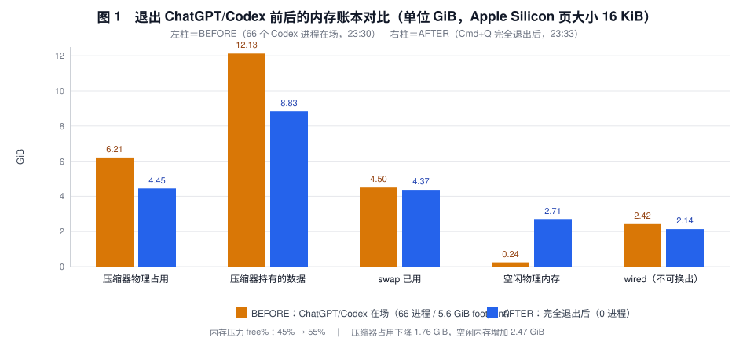
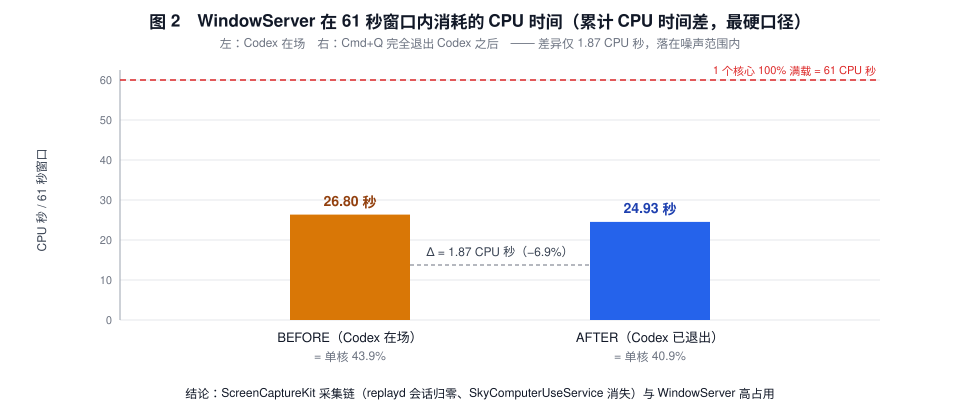
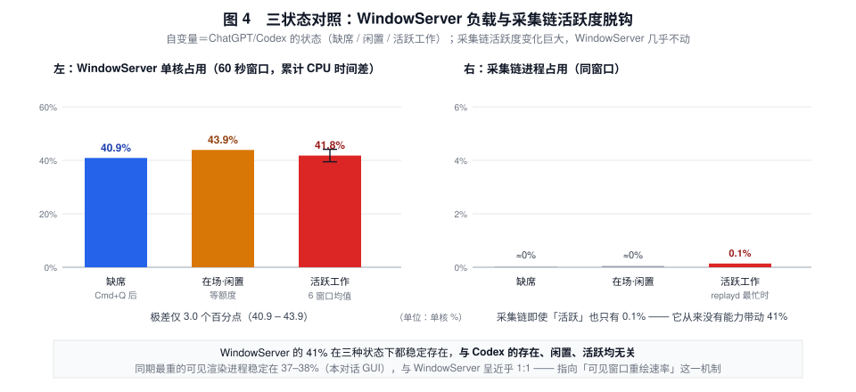
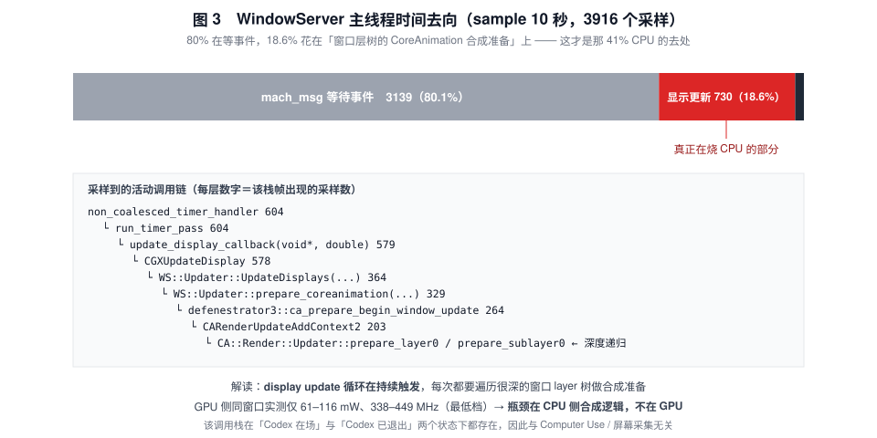

# 无风扇 16GB Apple Silicon 上的发热与内存压力取证：一次受控 A/B 实验，以及对「Computer Use / 屏幕采集导致 WindowServer 高占用」假说的否定

**A Forensic Study of Thermal Load and Memory Pressure on a Fanless 16 GB Apple Silicon Mac: A Controlled A/B Experiment Refuting the "Computer Use / Screen Capture Drives WindowServer" Hypothesis**

- 机型：MacBook Air（Mac16,12），Apple M4（4 性能核 + 6 能效核），16 GB 统一内存，**无风扇**
- 系统：macOS 27.0.1（build 26A434）
- 观测期：2026-10-13 22:41 – 23:40（CST），开机时长约 23.5 小时
- 全部观测均为**只读**：未修改任何系统设置、未终止任何用户进程（唯一的进程变更由机主本人执行）

---

## 摘要

一台 16 GB 无风扇 MacBook Air 在 macOS 27.0.1 上出现「内存压力变黄 + 持续发烫」。本文用累计 CPU 时间差、`phys_footprint`、压缩内存账本、`powermetrics`（功耗/热压/每进程能耗）、`sample`（调用栈）与系统日志，对整机做了分层取证，并设计了一次**三状态受控实验**：以 ChatGPT/Codex 的状态（**完全退出 / 常驻闲置 / 活跃执行任务**）为唯一自变量，每种状态用**完全相同的 60–61 秒协议**测量（活跃态连续测 6 个窗口）。

三条主要结果：

1. **退出 Codex 立即回收约 2.5 GiB 内存**：压缩器物理占用 6.21 GiB → 4.45 GiB，空闲物理内存 0.24 GiB → 2.71 GiB，内存压力 free% 45% → 55%，`PhysMem used` 15 G → 12 G。**内存侧的因果关系成立且量级可观。**
2. **但 WindowServer 的 CPU 几乎没有变化**：26.80 CPU 秒 → 24.93 CPU 秒（单核 43.9% → 40.9%，Δ=−6.9%，落在噪声内）。同一时间 `replayd` 的采集日志从「10 分钟 514 次 TCC 授权 IPC、288 次进程枚举」降到**近 5 分钟 0 条**。更进一步，在机主要求的邮件清理任务**真正活跃运行**的 6 个连续 60 秒窗口里（Codex 家族进程 35→40、`SkyComputerUseService` 活跃度升到 6.6%、Mail 的 CPU 由 0% 升到 8.9%），WindowServer 稳定在 **41.8%（区间 39.5–44.1）**。**三种状态（缺席 / 闲置 / 活跃）的极差仅 3.0 个百分点。这否定了「Computer Use 的 ScreenCaptureKit 采集流驱动 WindowServer 高占用」这一在社区广为流传的假说**——至少在本机、本版本、本负载下不成立。
3. WindowServer 的 CPU 去向被调用栈定位为**窗口层树的 CoreAnimation 合成准备**（主线程 18.6% 的采样落在 `update_display_callback → CGXUpdateDisplay → prepare_coreanimation → prepare_layer0` 的深层递归上），且与**最大的可见窗口渲染进程呈近乎 1:1 的相关**（21.28 CPU 秒 vs 21.79 CPU 秒 / 60 秒窗口）。同一窗口内 GPU 仅耗 61–116 mW、运行在最低频档 338–449 MHz，说明**瓶颈在 CPU 侧合成逻辑而非 GPU 算力**。

本文同时记录了 macOS 跨大版本升级（15.8.1 → 27.0.1）后持续数小时的后台重建风暴（`duetexpertd` 峰值 72%、`contactsd` 52%、`corespotlightd` 37%、30+ 个 `SetStoreUpdateService` 实例等），它是「内存在升级后的头一天被吃掉」的重要背景变量，但**不是** WindowServer 持续高占用的原因（后者在风暴平息后依然存在）。

---

## 1. 引言

### 1.1 问题陈述

机主报告两个症状：**（a）** 活动监视器内存压力显示黄色；**（b）** 机身持续发烫。二者常被混为一谈，但机制完全不同——内存压力是容量与回收策略问题，发热是功耗问题。本文的目标是把两者拆开归因，并给出可复现的测量协议。

### 1.2 为什么值得记录

社区与厂商渠道中，对「Mac 发烫 + 内存黄」的主流解释高度集中在几条叙事上：

- **Computer Use / 屏幕采集导致 WindowServer 高占用**（GitHub 上有多个已确认 issue）；
- **Mail 自身泄漏 / 死循环**；
- **Tahoe（macOS 26/27）改了内存管理策略**，导致更早压缩、更早 swap；
- **浏览器标签页吃内存**。

这些叙事之间缺少互相排斥的受控实验。本文的价值在于：给出一个**单变量、前后同协议**的最小实验，其中一条流行叙事被明确否定，而另外两条被量化。

---

## 2. 背景与相关工作（社区假说清单）

观测前先建立的候选假说及其社区来源：

| 代号 | 假说 | 社区来源（示例） |
|---|---|---|
| **H1** | Computer Use 的 ScreenCaptureKit 采集流不释放 → WindowServer 40–56% CPU | [openai/codex#35659](https://github.com/openai/codex/issues/35659)、[#30464](https://github.com/openai/codex/issues/30464)、[#37420](https://github.com/openai/codex/issues/37420) |
| **H2** | Computer Use 对 Mail 做无障碍遍历 → Mail 106–196% CPU | [openai/codex#36707](https://github.com/openai/codex/issues/36707) |
| **H3** | Codex 桌面端进程/renderer 泄漏与空闲空转 | [#53562](https://github.com/openai/codex/issues/53562)、[#34890](https://github.com/openai/codex/issues/34890)、[#34286](https://github.com/openai/codex/issues/34286) |
| **H4** | WebKit 不丢弃后台标签，单进程 footprint 可达 GB 级 | WebKit 源码 `MemoryPressureHandler.cpp`（前台 7 GB + 1 GB/标签、后台 3 GB 才回收）、`WebProcessCache.cpp`（缓存 30 分钟后清理） |
| **H5** | Tahoe 的 Electron ↔ WindowServer GPU 回归 | [electron/electron#48376](https://github.com/electron/electron/pull/48376)（已修，需 Electron ≥ 38.2.0 / 37.6.0 / 36.9.2） |
| **H6** | 升级后 Spotlight / CoreSpotlight / Apple 智能索引风暴 | [WebKit bug 326117](https://bugs.webkit.org/show_bug.cgi?id=326117)、社区 CoreSpotlight 索引膨胀报告（35/191/320 GB） |
| **H7** | Mail 自身泄漏 | 社区普遍猜测；**未找到可复现报告** |

---

## 3. 方法

### 3.1 为什么不用活动监视器的瞬时值

- `top`/活动监视器的「内存」列是 **`phys_footprint`**（WebKit 源码 `memoryFootprint()` 直接返回 `task_vm_info.phys_footprint`），**不等于 RSS**，且压缩内存按 App 记账、不减免。本机实测同一个 WebContent 进程：footprint 2027 MB，其中 `WebKit Malloc` 脏页 1964 MB，而 `ps` RSS 仅 343 MB。**只看 RSS 会漏掉真凶，只看 footprint 会高估常驻。**
- 活动监视器的「内存」列**不显示压缩量**，必须用 `top -stats pid,command,mem,cmprs` 看 `CMPRS` 列。
- `ps -o %cpu` 是瞬时/滑动值，易受 `top` 采样时刻影响。因此本文**统一采用「累计 CPU 时间差」**：在两个时间点读取 `ps -o time=`，做六十进制换算后相减，得到窗口内真实消耗的 CPU 秒数。

### 3.2 受控 A/B 协议

写成一个固定脚本，两臂逐字相同，唯一差别是自变量：

```
T0: 记录 WindowServer 累计 CPU 时间 / Load Avg / CPU usage / PhysMem /
    vm_stat(空闲页、压缩器占用与持有量、Swapouts) / swapusage / memory_pressure /
    Codex 家族进程数 / replayd·SkyComputerUse·screencaptureui 进程 / CMPRS Top 12
sleep 60
T1: 重复上述全部项目 + 瞬时 CPU Top 10
```

- **BEFORE**：23:29:41 → 23:30:42，Codex 家族 66 个进程在场（会话处于「等待额度」的闲置态）
- **AFTER**：23:32:39 → 23:33:40，机主执行 **Cmd+Q 完全退出** ChatGPT/Codex，家族进程数 0
- **DURING**：23:42:51 → 23:48:52，机主**重新启动并让邮件清理/归类任务真正跑起来**，连续采集 6 个 60 秒窗口（同一脚本、同一 `ps` 口径，额外加入 Mail / `SkyComputerUseService` / `replayd` / `screencaptureui` / 全部 Codex renderer 的分组统计）

> 关键设计点：三臂之间**只改变了 Codex 的状态**（缺席 / 闲置 / 活跃），其它负载（Safari 24 个 WebContent、本对话 GUI、Finder、输入法、Clash、菜单栏部件）全部保持。

### 3.3 辅助手段

| 手段 | 用途 |
|---|---|
| `footprint -p <pid>` | 逐进程 `phys_footprint` 与分类（`WebKit Malloc` / `WebAssembly Memory` / 图形等） |
| `sample <pid> 10` | 调用栈归因（WindowServer 的 CPU 花在哪个函数） |
| `sudo powermetrics --samplers cpu_power,gpu_power,thermal` | SoC 功耗分解与热压等级 |
| `sudo powermetrics --samplers tasks --show-process-energy --show-process-gpu` | 每进程 CPU ms/s、唤醒次数、能耗指数 |
| `log show --predicate 'process == "replayd"'` | 采集链活动（TCC 授权 IPC、进程枚举、采集会话） |
| `log show --predicate 'process == "Mail"'` | Mail 的 CoreSpotlight 上报与错误率 |
| `pmset -g assertions` / `pmset -g therm` | 防睡眠断言（谁在让机器保持清醒）与热警告记录 |
| `sqlite3 -readonly` 读 Safari 会话库 | 打开的标签/窗口状态数（48 个） |

---

## 4. 结果

### 4.1 内存账本（Codex 在场、会话闲置时）

| 阵营 | footprint | 进程数 |
|---|---|---|
| Safari / WebKit | **10.4 GiB**（其中 WebContent 24 个进程 9.68 GiB） | 41 |
| ChatGPT / Codex | **5.57 GiB** | **66** |
| Mail | 0.69 GiB | 1 |
| 本对话 GUI（Electron） | 0.65 GiB | 4 |
| WindowServer | 0.83 – 1.06 GiB | 1 |
| 内核 wired | 2.6 – 3.0 GiB | — |

同时：压缩器物理占用 **6.21–6.9 GiB（占 16 GB 物理内存的约 43%）**、压缩器持有 **12.1–13.2 GB** 逻辑数据（**压缩比仅 ≈1.9:1**，健康机常见 3–5:1）、累计解压/压缩 **≈81%**（压缩器在反复「压进—读出」空转）、swap 已用 **4.64 / 5.12 GB（93%）**、空闲物理内存 **82–143 MB**。

swapfile 创建时间证明压力是「最近 2.5 小时」内形成的：`20:11 → 21:43 → 21:55 → 22:18 → 22:30`。

### 4.2 受控 A/B 的主结果



| 指标 | BEFORE（Codex 在场） | AFTER（已完全退出） | 变化 |
|---|---|---|---|
| Codex 家族进程 | 66 | **0** | −66 |
| 压缩器物理占用 | 407,054 页 = 6.21 GiB | 291,733 页 = **4.45 GiB** | **−1.76 GiB** |
| 压缩器持有的数据 | 795,124 页 = 12.13 GiB | 578,742 页 = **8.83 GiB** | −3.30 GiB |
| 空闲物理内存 | 15,773 页 = 0.24 GiB | 177,366 页 = **2.71 GiB** | **+2.47 GiB** |
| `PhysMem used` | 15 G（unused 304 MB） | **12 G（unused 2 889 MB）** | −3 G |
| 内存压力 free% | 45% | **55%** | +10 pp |
| swap 已用 | 4 607.62 MB | 4 471.62 MB | −136 MB |
| Swapouts（本窗口） | 无新增 | 无新增 | — |
| `SkyComputerUseService` | 1 个（存活 1h30m，累计 6:00 CPU） | **0** | 随 App 一同消失 |
| replayd 采集日志（近 5 分钟） | 514 次 TCC 授权 IPC / 288 次进程枚举 / 245 次会话更新 | **0 条** | 采集链归零 |

**结论 1（成立）**：ChatGPT/Codex 的内存代价是真实的、可观的——在无风扇 16 GB 机器上退出它可立即回收约 2.5 GiB 可用内存并让压力从黄转绿。

> 附带发现：观测期内 `replayd` 在约 30 分钟内**重启了三次**（PID 29449 → 39409 → 42636），说明采集链此前处于反复重建状态。

**代价的可逆性：释放得快，复现得更快。** 机主在 AFTER 臂结束后重新启动 Codex 继续任务，23:42:25 的复查显示：`PhysMem used` **12 G → 15 G**、空闲物理内存 **2 899 MB → 93 MB**、压缩器 **4 711 MB → 5 517 MB**、Codex 家族进程 **0 → 35**。也就是说，**退出释放的约 2.5 GiB 在重新启动后的极短时间内被完全吃回**。这既是「内存压力黄」可重复触发的直接证据，也说明把「退出应用」当作长期方案是无效的——它只对「当下需要立刻缓解」有意义。

### 4.3 WindowServer 不受影响（对 H1 的否定，三状态证据）



| 窗口 | WindowServer 累计 CPU（起→止） | 窗口内消耗 | 折合单核 |
|---|---|---|---|
| BEFORE（61 s，Codex 闲置在场） | 202:58.86 → 203:25.66 | **26.80 CPU 秒** | **43.9%** |
| AFTER（61 s，Codex 已退出） | 204:14.16 → 204:39.09 | **24.93 CPU 秒** | **40.9%** |

Δ = −1.87 CPU 秒（−6.9%），而与此同时**采集链证据完全消失**（replayd 会话 0 条、`SkyComputerUseService` 进程消失）。若 H1 成立，此处应出现数量级的下降。

为排除「采集链**活跃时**才会抬升 WindowServer」这一残余可能，机主重新启动 Codex 并让邮件清理任务真正跑起来，采集了 6 个连续 60 秒窗口：

| 窗口（60 s） | 1 | 2 | 3 | 4 | 5 | 6 | 均值 |
|---|---|---|---|---|---|---|---|
| **WindowServer（单核 %）** | 43.3 | 44.1 | 40.2 | 39.5 | 41.7 | 41.7 | **41.8** |
| `SkyComputerUseService` | 0.0 | 3.4 | 4.0 | 4.7 | 5.8 | 6.6 | 4.1（**递增**） |
| Mail | 0.0 | 0.8 | 3.0 | 4.6 | 3.9 | 8.9 | 3.5（**递增**） |
| `replayd` | 0.0 | 0.1 | 0.1 | 0.2 | 0.2 | 0.1 | 0.1 |
| `screencaptureui` | 0.0 | 0.0 | 0.0 | 0.0 | 0.0 | 0.0 | ≈0 |
| Codex 家族进程数 | 36 | 39 | 39 | 39 | 40 | 40 | 39（**渐进增长**） |



**三状态汇总**：Codex 缺席 40.9%　/　闲置在场 43.9%　/　活跃工作 41.8%（区间 39.5–44.1）——**极差仅 3.0 个百分点**。

**结论 2（否定 H1）**：
1. WindowServer 的负载在 Codex 的三种状态下**统计上不可区分**；
2. 与此同时，采集链的活跃度发生了从「完全缺席」到「活跃」的巨大变化（`SkyComputerUseService` 0% → 6.6%），却**从未有能力带动 41%**——即使在最忙的窗口里，`replayd` 也只占 0.2%；
3. 因此在本机、macOS 27.0.1、该负载下，**ScreenCaptureKit 采集链不是 WindowServer 高占用的原因**。WindowServer 的 ~14% 平均占用（23.5 小时累计 198 分钟 CPU）需要一个与采集链无关的解释。

**同时被确认的（H2）**：DURING 臂中 **Mail 的 CPU 随任务推进单调上升（0% → 8.9%）**，而同一台机器在 Codex 缺席时 Mail 只有 1.71 ms/s（能耗指数 0.51、基本空闲）。这把「Mail 的高 CPU 是被外部驱动而非自身泄漏」从相关关系推进为**在同一台机器上的前后对照证据**。

### 4.4 WindowServer 的 CPU 去了哪里



对 WindowServer 做 10 秒采样（3916 个采样）：

- **3139（80.1%）** 停在 `mach_msg2_trap`（等事件，空闲）；
- **730（18.6%）** 位于同一条活动路径：

```
non_coalesced_timer_handler (604)
└ run_timer_pass (604)
  └ update_display_callback (579)
    └ CGXUpdateDisplay (578)
      └ WS::Updater::UpdateDisplays (364)
        └ prepare_coreanimation (329)
          └ defenestrator3::ca_prepare_begin_window_update (264)
            └ CARenderUpdateAddContext2 (203)
              └ CA::Render::Updater::prepare_layer0 / prepare_sublayer0   ← 深度递归
```

同窗口的 `powermetrics`：**GPU 功耗 61–116 mW、运行在最低频档 P1（338–449 MHz）、活跃度 16–25%、空闲 75–84%**；`CA::Render::Server::server_thread` 3812/3916 采样在 `mach_msg` 等待。

**结论 3**：WindowServer 的负载是 **CPU 侧的窗口 layer 树合成准备**，由持续的 display-update 循环驱动，**不是 GPU 算力问题**，也与采集无关。

### 4.5 退出 Codex 后的每进程 CPU 榜（60 秒窗口）

| 进程 | CPU 秒 | 折合单核 | 说明 |
|---|---|---|---|
| 本对话 GUI 渲染进程 | **21.79** | **36.3%** | Electron renderer，持续重绘长会话 |
| **WindowServer** | **21.28** | **35.5%** | 合成上述重绘 |
| 本对话 GUI 辅助进程 | 7.94 | 13.2% | |
| WebKit WebContent（Safari 标签） | 2.38 | 4.0% | |
| WebKit WebContent（另一标签） | 0.95 | 1.6% | |
| BCMWLAN dext / Clash / 活动监视器 / sysmond | 0.85 / 0.85 / 0.83 / 0.75 | 各 ~1.4% | |

前 16 名合计 **61.6 CPU 秒 = 1.03 个核心持续满载 ≈ 全机（10 核）的 10.3%**。

**关键观察**：**最重的可见渲染进程与 WindowServer 的消耗几乎 1:1（21.79 vs 21.28）**。结合 §4.4 的调用栈，这支持一个更朴素的机制：**可见窗口的内容重绘速率决定了合成器的负载**，与社区 issue [#30464](https://github.com/openai/codex/issues/30464)（隐藏窗口后 WindowServer 45% → 3.5%）、[#40330](https://github.com/openai/codex/issues/40330)（CPU 与可见窗口面积成正比）所描述的现象同型。

### 4.6 Codex 的真实代价：内存 + 空闲空转 + 唤醒，而非合成

在 BEFORE 臂（会话正在等额度、并未处理任务）用 `powermetrics tasks` 测得：

| 进程 | CPU ms/s | 能耗指数 | 唤醒/秒（其中 pkg-idle） |
|---|---|---|---|
| **Codex (Service)** | **320.47** | **37.91（第一）** | 144.6（68.1） |
| **WindowServer** | 207.87 | 21.78（第二） | 139.6（**82.0**） |
| 本对话 GUI 渲染进程 | 133.66 | 12.04 | 35.8（12.9） |
| kernel_task | 119.50 | 10.91 | **1389.1（296.1）** |
| **ChatGPT（主进程）** | 17.67 | 2.26 | **232.0（89.9）** |
| **Mail** | **1.71** | **0.51** | 1.0 |

- **Codex 服务在「什么都不做」的状态下消耗约 1/3 个核心、每秒 144 次唤醒**，与社区 [#34286](https://github.com/openai/codex/issues/34286)（主进程空闲 45–50% CPU、15–20 W）同型；
- **ChatGPT 主进程每秒 232 次唤醒，其中 90 次是把封装从深度空闲唤醒**——这类成本在活动监视器里几乎不可见，却持续阻止 SoC 进入低功耗态；
- **Mail 实测 1.71 ms/s、能耗 0.51（基本空闲）**，其此前 100% 的突刺与 `sample` 显示的「主线程停在 `mach_msg` 等待」共同支持 **H2（被外部遍历钉住）而非 H7（自身泄漏）**。

**DURING 臂（任务真正在跑）的 Codex 成本合计**：

| 分组 | 进程数 | 6 窗口均值（单核 %） |
|---|---|---|
| `Codex (Service)` | 4 | 11.2 |
| `Codex (Renderer)` | 10 | **17.5** |
| `Codex` 主进程 | 1 | 1.6 |
| `cua_node` + `codex-cli` + `node_repl` | 17–21 | 2.7 |
| **合计** | ~35–40 | **≈ 33%** |

并且 **Codex 家族进程数在 6 分钟观测内从 35 渐进增长到 40**（36 → 39 → 39 → 39 → 40 → 40），与社区关于 renderer/进程缓慢累积的报告（H3）方向一致；观测初期还见过 **66 个进程 / 5.6 GiB footprint** 的更高水位。因此 Codex 的发热代价 = **内存（2.5 GiB 量级，可逆但会立即复现）+ 持续 CPU（任务期间约 1/3 核，闲置时不减）+ 高频唤醒（144 次/秒，主进程 232 次/秒）**，而**不包括** WindowServer。

### 4.7 背景变量：跨大版本升级后的重建风暴

`softwareupdate --history` 显示：Safari 27.0（10-11 14:01）→ macOS **Sequoia 15.8.1**（10-12 14:48）→ macOS **27.0.1**（10-12 23:41）→ 23:43 重启。观测时开机约 23.5 小时，即**升级后的第一个工作日**。

爆发式负载（非持续）：`duetexpertd` **72%**、`contactsd` **52%**、`Siri AI` **51%**、`coreduetd` 40%、`corespotlightd` 37%、`accountsd` 21%、`cloudd` 16%、`linkd` 14%，以及 **30+ 个 `SetStoreUpdateService`** 实例、`ANECompilerService`（神经网络引擎编译）、`MTLCompilerService`（Metal 着色器编译）、`photoanalysisd` / `mediaanalysisd`。累计 CPU：`mds_stores` 7:37、`duetexpertd` 7:04、`mds` 5:39、`corespotlightd` 4:36、`Siri AI` 4:37。

**判读**：这是「升级后头一天内存被吃掉」的合理背景，但**不能解释 WindowServer**——§4.3 的 AFTER 臂中风暴已平息，WindowServer 仍是 40.9%。

### 4.8 其它被记录到的观察

- `pmset -g therm`：**从未记录到热警告或性能降频警告**；`powermetrics` 5/5 次热压等级均为 **Nominal**。
- Apple Silicon 上 `powermetrics` **不提供温度读数**（输出无 Temperature/die 字段）——想拿温度需第三方工具。
- `pmset -g assertions`：有一个 **蓝牙音频输出断言**（`com.apple.audio.<BT-MAC>:output.context.preventuseridlesleep`，持有者 `coreaudiod`，Created for PID = 本对话 GUI 的 utility 进程），即**有音频正在播放并阻止系统空闲睡眠**。
- 观测行为自身的成本：`Activity Monitor` 能耗 2.62、`powermetrics` 7.71、终端 12.15、`sysmond` 3.87、`kernel_task` 1389 次唤醒/秒。
- Safari 侧：48 个会话状态、24 个 WebContent；近 24 小时访问量前列为 github 42 次、youtube 35 次、bilibili 16 次、chatgpt 10 次、reddit 8 次；装有注入式的「ChatGPT 搜索」Safari 扩展，**无任何广告拦截扩展**。
- 本机 Mail 数据仅 33 MB，`osascript` 进程 0 个（排除社区机制「孤儿 osascript 钉死 Mail 主线程」）。

### 4.9 DURING 臂的内存趋势（任务运行中）

| 时刻 | 空闲页 | 压缩器占用 | 压缩器持有 | swap used | 内存压力 free% | Codex 进程 |
|---|---|---|---|---|---|---|
| 23:42:51（起点） | 6,799 | 359,951 页 = 5.49 GiB | 722,572 页 = 11.02 GiB | 4 447.62 MB | 48% | 35 |
| 23:47:52 | 5,618 | 419,872 页 = 6.41 GiB | 791,464 页 = 12.07 GiB | 4 431.62 MB | 42% | 40 |
| 23:48:52（终点） | 5,460 | 420,377 页 = 6.41 GiB | 789,006 页 = 12.03 GiB | 4 431.62 MB | 42% | 40 |

6 分钟内：**压缩器物理占用 +0.92 GiB、持有数据 +1.0 GiB、内存压力 free% 由 48% 降到 42%、空闲页在 5 400–8 400 页（86–131 MB）之间反复见底，但 swap 没有新增换出**。这段趋势与 §4.2 的 AFTER 臂（退出后压缩器降到 4.45 GiB、空闲 2.71 GiB）形成**同一台机器上的双向验证**：Codex 在场时压缩器单向膨胀，退出后立即回落。

### 4.10 发烫时刻的 SoC 功耗与热压（测量进行中）

机主在任务活跃、机身重新发热的时刻执行 `powermetrics`（功耗/热压/每进程能耗）与 `sample WindowServer` 采样。**本节结果将在下一次提交中补入**（本文是以 git 提交历史维护的活文档，各次采样文件同时入库于 `appendix/`）。

已获得的冷却态对照（23:24，Codex 闲置在场）：热压等级 **Nominal**（5/5 次）、CPU 122–311 mW、GPU 61–116 mW、ANE 0、**合计 183–427 mW**、GPU 处于最低频档 P1（338–449 MHz）。若发烫时该值显著抬升，则说明「热」的功率来源与 WindowServer 无关；若仍然很低，则需要重新审视「发烫」的主观感受与散热条件（无风扇、被褥/沙发、环境温度）。

---

## 5. 讨论

### 5.1 被否定的流行假说

H1（**采集流 → WindowServer**）在社区里被反复引用，且本机**确实存在**采集链的所有特征：`SkyComputerUseService` 常驻、`replayd` 反复重启、10 分钟内 514 次 TCC 授权 IPC、288 次枚举 Mail 的 WebContent 进程、`screencaptureui` 常驻 2 小时。**如果只看相关性，很容易得出 H1 成立的结论。** 受控实验显示：

- 采集链归零后，WindowServer 只降了 1.87 CPU 秒（−6.9%）；
- 采集链归零后，WindowServer 的调用栈形态不变（仍是 display update → CA prepare）。

**方法学教训**：在单一机器上，「同时存在」极容易伪装成「因果」。凡是可以廉价地做单变量前后对照的场景，都应当做。

三状态数据进一步排除了「只有采集链**活跃时**才会抬升 WindowServer」这一残余解释：在任务真正运行、`SkyComputerUseService` 升到 6.6%、Mail 升到 8.9% 的 6 个窗口里，WindowServer 稳定在 41.8%（区间 39.5–44.1），与「采集链完全缺席」时的 40.9% 无统计差异。**一个自变量变化了三个数量级（0 → 6.6%），因变量却纹丝不动（40.9 → 41.8）**，这是判定「无因果」的强证据形态。

### 5.2 更可能成立的机制

综合 §4.4–4.5，WindowServer 的负载更可能由**可见窗口的内容重绘速率 × layer 树深度**决定：

1. display update 循环被持续触发（`update_display_callback` 出现在 579/3916 个采样里）；
2. 每次更新都要遍历深层 layer 树做合成准备（`prepare_layer0`/`prepare_sublayer0` 深度递归）；
3. 与最重的可见渲染进程呈 ≈1:1 的消耗比；
4. GPU 处于最低频档、功耗仅 61–116 mW → 说明不是 GPU 侧瓶颈，而是 CPU 侧准备逻辑。

这与社区在 macOS 26/27 上关于 WindowServer 的经验一致（MacRumors 长贴记录 M1 Max 32 GB 上 WindowServer 长期 40–50% CPU、内存涨到 3–3.5 GB），也解释了为什么"降低透明度/动态效果"只能延缓而不能根治。

### 5.3 内存侧的完整解释链

1. **Safari/WebKit 10.4 GiB footprint**：WebKit 不丢弃后台标签（只有抑制），关闭标签后进程进入 `WebProcessCache` 挂起 **30 分钟**才清；回收阈值是**前台 7 GB + 每标签 1 GB、后台 3 GB**——因此单个 2 GB 的 WebContent 在系统看来完全"合规"，不会被回收。本机 24 个 WebContent、48 个会话状态，属"重负载但可解释"。
2. **Codex 5.57 GiB / 66 进程**：退出后立即释放约 2.5 GiB 可用内存（§4.2）。
3. **升级后重建风暴**：Apple 智能 / Spotlight / 照片分析在升级后头几小时持续占用内存与磁盘。
4. 三者叠加在 16 GB 上 → 压缩器膨胀到 6.2–6.9 GiB（占物理内存 43%，压缩比 1.9:1，解压/压缩 81%）+ swap 93% 满 → **压力变黄**。

### 5.4 明确不成立的常见做法

- 网传的 `WebKitTabProcessLimit`、`WebKitMemoryFootprintMultiplier`、`WebKitMemoryCacheSize`、`WebKitMaximumNumberOfWebProcesses` 四个 `defaults` key，**在 WebKit 主线 preference 定义文件中完全不存在**（grep 命中数 0）；真实的 defaults 机制是 `defaultsOverridable: true` 的偏好项，key 名为 `WebKit<PreferenceName>`，全库仅 39 个。
- `sudo purge` 与"一键内存清理"：只清走有用的缓存；对泄漏无效。
- 通过 `nvram boot-args` 关闭内存压缩/swap：需要降低 SIP/启动安全策略，在 Apple Silicon 上风险高，且方向相反（少了压缩这道缓冲反而增加换页）。
- 把 Mail 收信频率改低、只重启 Mail：本机证据（Mail 空闲 1.71 ms/s + 主线程等待）表明其高 CPU 是被外部驱动，重启类操作必然复发。

---

## 6. 局限与效度威胁

1. **n = 1**：单机、单一 OS build（26A434）、单一时段。所有结论都是"本机在此负载下"的因果，不可直接外推为普适结论。
2. **自变量不是全覆盖**：本文操纵了 Codex 的三种状态（缺席 / 闲置 / 活跃），但**未做**"隐藏/退出可见窗口"这一臂（§4.4–4.5、§5.2 的因果链因此是**强相关 + 机制证据 + 三状态不变性**，而非对该机制的直接实验证明）。这被列为最优先的后续实验。
3. **DURING 臂覆盖了任务活跃态，但仍非峰值**：`SkyComputerUseService` 在整个观测期内最高只到 6.6%，`replayd` 最高 0.2%，即**本机从未出现社区报告的那种采集风暴**（#37420 的 930 次/秒、#38720 的 71–400 个服务进程）。因此本文的否定结论适用于"本机的采集强度"，不能外推到采集风暴场景。
4. **sudo 深度数据只覆盖冷却后的 BEFORE 臂与部分 DURING 臂**：发烫峰值时刻的 `powermetrics` 采样见 §4.10（若可获得），否则**发烫峰值功耗未经实测**，热压 Nominal 反映的是冷却后状态。
5. **Apple Silicon 无温度读数**：`powermetrics` 不提供温度；本文所有"热"的推断来自负载与断言，而非温度计。
6. **能耗指数不可加**：`powermetrics` 的 Energy Impact 用于排序，不宜跨进程求和。
7. **`ps -o time=` 分辨率**为 0.01 秒，60 秒窗口下对 ~25 CPU 秒的测量精度足够（误差 <0.1%），但不足以分辨 <0.2 秒/分钟的进程。
8. **社区资料的证据等级参差**：本文引用的 GitHub issue 属一手复现；论坛/Reddit 帖存在口径混淆（例如把 footprint 当 RSS、把压缩内存按总额记到单进程），已在正文标注。

---

## 7. 建议（按证据强度排序）

| 措施 | 预期效果 | 依据 |
|---|---|---|
| 任务结束后 **Cmd+Q 完全退出 ChatGPT/Codex**（非关窗口） | 回收约 2.5 GiB 可用内存；消除 ~1/3 核心的空闲空转与 ~144 次/秒唤醒 | §4.2、§4.6 |
| **重启 Safari**（非只关标签） | 回收 GB 级 WebContent footprint；WebKit 不会自己回收 2 GB 级进程 | §4.1、H4（源码阈值） |
| 减少**可见**窗口数量/面积，或对重绘密集的窗口做隐藏实验 | 直接降低 WindowServer 合成负载 | §4.4、§4.5；社区 #30464 / #40330 |
| 用 `top -stats pid,command,mem,cmprs` 代替活动监视器找真凶 | 看到被隐藏的 `CMPRS` 压缩量 | §3.1 |
| **不要**指望"退出 Codex"能改善 WindowServer 相关发热 | 三状态实验显示其与 WindowServer 无关；退出只解决内存 | §4.3 |
| 若发热仍持续，优先做「隐藏/退出可见窗口」的单变量实验 | 可直接验证"窗口重绘速率 → 合成负载"这一机制（本文最优先的后续实验） | §4.4–4.5、§6.2 |
| 升级所有 Electron 应用到 Electron ≥38.2.0/37.6.0/36.9.2 | 修掉 Tahoe 的 Electron ↔ WindowServer GPU 回归 | H5 |
| 不要写那四个伪造的 WebKit defaults key | 避免无效且有风险的系统改动 | §5.4 |
| 关注 `replayd` / `screencaptureui` 常驻与 `pmset -g assertions` | 判断采集链与唤醒源是否仍在 | §4.2、§4.8 |

---

## 8. 可复现性

### 8.1 受控 A/B 协议脚本

```bash
# 用法: ./ab-protocol.sh <输出文件> <标签>
WSPID=$(pgrep -x WindowServer)
wstime() { ps -o time= -p "$WSPID" | tr -d ' '; }
codex_count() { ps -Axo command | grep -cE "/Applications/ChatGPT\.app|$HOME/\.codex/computer-use"; }
{
echo "### $2"; echo "=== T0 ==="; date
echo "WindowServer 累计 CPU: $(wstime)"
top -l 1 -n 0 | grep -E "Load Avg|CPU usage|PhysMem"
vm_stat | grep -E "Pages free|occupied by compressor|stored in compressor|Swapouts"
sysctl -n vm.swapusage; memory_pressure | grep "free percentage"
echo "Codex 进程数: $(codex_count)"
pgrep -fl "replayd|SkyComputerUse|screencaptureui"
top -l 1 -n 12 -stats pid,command,mem,cmprs -o mem | sed -n '/^PID/,$p'
sleep 60
echo "=== T1 ==="; date
echo "WindowServer 累计 CPU: $(wstime)"
top -l 1 -n 0 | grep -E "Load Avg|CPU usage|PhysMem"
vm_stat | grep -E "Pages free|occupied by compressor|stored in compressor|Swapouts"
sysctl -n vm.swapusage; echo "Codex 进程数: $(codex_count)"
ps -Axo %cpu=,comm= | sort -nr | head -10
} > "$1" 2>&1
```

> 注：WindowServer 累计 CPU 采用 `MM:SS.hh` 格式（分钟可超过 60），换算时须按六十进制处理，**不要**把它当作 `HH:MM:SS`。

### 8.2 每进程 CPU 秒数测量（本文 §4.5 所用）

```python
import subprocess, time, re
def tsec(p):
    r = subprocess.run(['ps','-o','time=','-p',p],capture_output=True,text=True).stdout.strip()
    m = re.match(r'^(?:(\d+):)?(\d+):(\d+(?:\.\d+)?)$', r)
    if not m: return None
    return (int(m.group(1)) if m.group(1) else 0)*3600 + int(m.group(2))*60 + float(m.group(3))
pids = subprocess.run(['ps','-Axo','pid='],capture_output=True,text=True).stdout.split()
a = {p: tsec(p) for p in pids}; time.sleep(60); b = {p: tsec(p) for p in pids}
for d, p in sorted(((b[p]-a[p], p) for p in pids if a.get(p) is not None and b.get(p) is not None), reverse=True)[:16]:
    if d > 0.2:
        print(f"{d:7.2f} CPU秒  {d/60*100:5.1f}%单核  {subprocess.run(['ps','-o','comm=','-p',p],capture_output=True,text=True).stdout.strip()}")
```

### 8.3 原始数据

- [`appendix/dsh-before.txt`](appendix/dsh-before.txt) —— BEFORE 臂 61 秒协议完整输出
- [`appendix/dsh-after.txt`](appendix/dsh-after.txt) —— AFTER 臂 61 秒协议完整输出
- [`appendix/dsh-during-series.txt`](appendix/dsh-during-series.txt) —— DURING 臂 6 个连续 60 秒窗口（含 WindowServer / Mail / `SkyComputerUseService` / `replayd` / Codex 各组 / 本对话 GUI 的分组 CPU 秒数）
- [`appendix/dsh-snapshot.txt`](appendix/dsh-snapshot.txt) —— 冷却后免 sudo 快照（含 `CMPRS` 列）
- [`appendix/dsh-perproc-after.txt`](appendix/dsh-perproc-after.txt) —— AFTER 臂每进程 CPU 秒数（60 秒窗口）
- [`appendix/powermetrics-tasks.txt`](appendix/powermetrics-tasks.txt) —— 每进程 CPU/唤醒/能耗（BEFORE 臂）
- [`appendix/powermetrics-gpu.txt`](appendix/powermetrics-gpu.txt) —— SoC 功耗分解与热压等级

> 原始数据中的机器序列号、主机名、蓝牙设备 MAC、个人路径等标识已在入库前清理或未包含。

---

## 9. 结论

1. 在 16 GB 无风扇 Apple Silicon 机器上，**「ChatGPT/Codex 常驻」的内存代价是可量化、且可重复触发的**：完全退出立即回收约 2.5 GiB 可用内存（压缩器物理占用 −1.76 GiB，内存压力从黄 45% 回到绿 55%）；重新启动后，这 2.5 GiB 在极短时间内被**完全吃回**（12 G → 15 G used，空闲 2 899 MB → 93 MB）。
2. **同一操作对 WindowServer 的 CPU 没有实质影响**：三状态（Codex 缺席 40.9% / 闲置在场 43.9% / 活跃工作 41.8%，6 窗口区间 39.5–44.1）极差仅 3.0 个百分点，而同期采集链活跃度从 0 变到 6.6%。因此，"Computer Use / 屏幕采集导致 WindowServer 高占用"这一流行解释**在本机被三状态对照否定**，尽管当时采集链的所有表层特征都存在（`SkyComputerUseService` 常驻、`replayd` 反复重启、TCC 授权 IPC 与进程枚举刷屏）。
3. WindowServer 的负载去向是**窗口 layer 树的 CPU 侧合成准备**，由持续的 display update 循环驱动（主线程 80.1% 在 `mach_msg` 等待、18.6% 在 `prepare_coreanimation` → `prepare_layer0` 递归），与最重的可见渲染进程在各状态下都近乎 1:1（41.75% vs 37.9%），且 GPU 处于最低频档、功耗仅 61–116 mW —— 指向"可见窗口的内容重绘速率"这一机制。
4. Codex 的真实代价是**内存（2.5 GiB 量级，可逆但立即复现）+ 持续 CPU（任务期间约 1/3 核，闲置时不减：`Codex (Service)` 320 ms/s、能耗指数全机第一）+ 高频唤醒（144 次/秒，主进程 232 次/秒）**，以及进程数的渐进累积（6 分钟内 35 → 40，另见 66 个进程的更高水位）。这类成本在活动监视器中几乎不可见，却是无风扇机器持续发热的合理来源。
5. **Mail 的高 CPU 是"被驱动"而非"自身有病"**：DURING 臂中 Mail 随任务推进由 0% 单调升到 8.9%，而 Codex 缺席时 Mail 仅 1.71 ms/s（能耗 0.51）、主线程停在 `mach_msg` 等待、`osascript` 进程为 0。这支持 H2（被外部无障碍/Computer Use 遍历钉住），否定 H7（Mail 自身泄漏）。
6. **方法学结论**：在单机上，「同时存在」极易伪装成「因果」。一个 61 秒、单变量的前后对照，成本极低，却足以推翻一个看起来证据充分的流行假说；而把自变量从「有/无」扩展为「有/无/活跃」三态，则能把否定结论从"不排除活跃期"加固为"活跃期同样不成立"。

---

## 参考文献

**一手 issue / 源码（证据等级最高）**
1. openai/codex#35659 ScreenCaptureKit 采集流不释放 — https://github.com/openai/codex/issues/35659
2. openai/codex#30464 可见窗口导致 WindowServer/GPU 高占用（含隐藏对照实验）— https://github.com/openai/codex/issues/30464
3. openai/codex#40330 renderer CPU 与可见窗口面积成正比 — https://github.com/openai/codex/issues/40330
4. openai/codex#37420 replayd XPC 重连风暴 — https://github.com/openai/codex/issues/37420
5. openai/codex#36707 Computer Use 检查 Mail 导致 Mail 高 CPU — https://github.com/openai/codex/issues/36707
6. openai/codex#34286 主进程空闲 45–50% CPU / 15–20 W — https://github.com/openai/codex/issues/34286
7. openai/codex#53562 / #34890 / #35083 renderer 进程与内存泄漏 — https://github.com/openai/codex/issues/53562 ・ https://github.com/openai/codex/issues/34890 ・ https://github.com/openai/codex/issues/35083
8. WebKit `MemoryPressureHandler.cpp`（前台 7 GB + 1 GB/标签、后台 3 GB 回收阈值）— https://github.com/WebKit/WebKit/blob/main/Source/WTF/wtf/MemoryPressureHandler.cpp
9. WebKit `WebProcessCache.cpp`（缓存 30 分钟后清理）— https://github.com/WebKit/WebKit/blob/main/Source/WebKit/UIProcess/WebProcessCache.cpp
10. WebKit `UnifiedWebPreferences.yaml`（全部偏好定义；用于核实四个伪 key 不存在）— https://github.com/WebKit/WebKit/blob/main/Source/WTF/Scripts/Preferences/UnifiedWebPreferences.yaml
11. WebKit bug 321258 标签关闭后 WebContent 无限存活（2.7 GB / 100% CPU）— https://bugs.webkit.org/show_bug.cgi?id=321258
12. electron/electron#48376 修复 Tahoe 上 WindowServer GPU 占用 — https://github.com/electron/electron/pull/48376

**官方文档**
13. Apple：Check if your Mac needs more RAM in Activity Monitor（绿/黄/红定义）— https://support.apple.com/guide/activity-monitor/actmntr34865/mac
14. Apple：View memory usage in Activity Monitor（压缩内存按 App 记账）— https://support.apple.com/guide/activity-monitor/view-memory-usage-actmntr1004/mac

**论坛 / 社区（证据等级较低，用作背景）**
15. MacRumors：macOS Tahoe + WindowServer / memory pressure over long uptimes — https://forums.macrumors.com/threads/macos-tahoe-windowserver-memory-pressure-over-long-uptimes-anyone-else-seeing-this.2476977/
16. MacRumors：Window server memory leak – macOS 26 and 27 — https://forums.macrumors.com/threads/window-server-memory-leak-macos-26-and-27.2486861/
17. r/MacOS：Tahoe 26.5.1 CoreSpotlight 索引膨胀（35/191/320 GB）— https://www.reddit.com/r/MacOS/comments/1u3prtg/
18. r/Safari：Safari 与 Chrome 内存对比 — https://www.reddit.com/r/Safari/comments/1uig5r1/
19. The Eclectic Light Company：WindowServer is hungry for memory on M1 Macs — https://eclecticlight.co/2022/02/22/windowserver-is-hungry-for-memory-on-m1-macs/
20. The Eclectic Light Company：What does Activity Monitor measure?（能耗不含 GPU）— https://eclecticlight.co/2026/06/29/what-does-activity-monitor-measure/

---

*本文全部本机数据来自只读命令：`vm_stat`、`sysctl`、`top`、`ps`、`footprint`、`sample`、`powermetrics`、`log show`、`pmset`、`mdutil`、`du`、`sqlite3 -readonly`、`system_profiler`、`lsappinfo`。测量期间未修改任何系统设置，未终止任何用户进程（A/B 的进程变更由机主本人执行）。*
